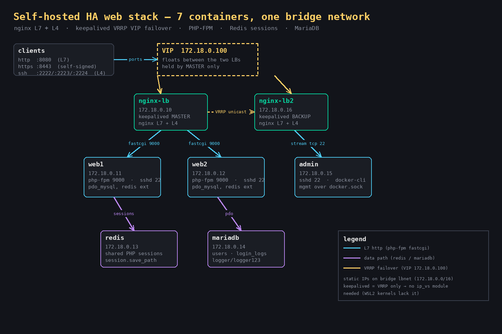

# Self-hosted HA web stack — nginx (L7 + L4) + keepalived VIP

Seven Docker containers on one bridge network, giving a single-host deployment the two things
cloud load balancers normally provide: **a floating VIP that survives a front-end failure**, and
**application backends that can be added or killed without logging users out**.

Everything here is verified by a script, not by description: `bash scripts/verify.sh` runs 19
checks end to end and writes a log. The screenshot of that output is in
`docs/verify-evidence.png`; the raw log is in `docs/verify-*.log`.



> **Demo credentials — local sandbox only.** The containers ship with throwaway passwords
> (`root:root` for the in-container sshd, `MARIADB_ROOT_PASSWORD=root123`) and publish ports
> 8080 / 443 / 2222 plus a TCP proxy to SSH on the host. They are built for a single local
> machine behind a firewall. If you deploy this stack anywhere reachable, change every
> credential, disable password logins, and do not publish port 2222.
>
> Nothing real is exposed by this repository: the `172.18.0.x` addresses are the project's own
> Docker bridge subnet (identical on every machine that clones it), `lb/certs/` is generated on
> first run and never committed, and there is no `.env`, hostname, public IP or key material
> anywhere in the history.

## What it does

| container   | IP           | role |
|-------------|--------------|------|
| nginx-lb    | 172.18.0.10  | nginx L7 (fastcgi → PHP-FPM) + L4 (stream → SSH) · keepalived **MASTER** |
| nginx-lb2   | 172.18.0.16  | same image · keepalived **BACKUP** (takes over the VIP) |
| web1        | 172.18.0.11  | PHP 8.2-FPM · sshd · php redis extension |
| web2        | 172.18.0.12  | identical, so a request can land on either one |
| admin       | 172.18.0.15  | ops shell with `docker-cli` over the mounted docker socket |
| redis       | 172.18.0.13  | shared PHP session store |
| mariadb     | 172.18.0.14  | `users` + `login_logs` |

**VIP = 172.18.0.100**, held by exactly one LB at a time.

## Quick start

```bash
bash scripts/up.sh        # self-signed cert + build + start the 7 containers
bash scripts/verify.sh    # 19 checks, writes logs/verify-<ts>.log
bash scripts/down.sh      # stop and remove everything
```

Look at it in a browser: <http://127.0.0.1:8080/index.php> — the page prints **which backend
served the request**, the session id, and the session store. Refresh it a few times: the backend
alternates and the session follows you.
HTTPS (self-signed): <https://127.0.0.1:8443/index.php>. L4 SSH: `ssh -p 2222 root@127.0.0.1`
(demo credentials `root/root`).

Management, from inside the network:

```bash
docker exec admin mgmt net                    # container → IP map
docker exec admin mgmt logins                 # which backend handled how many logins (via mariadb)
docker exec admin mgmt db "SELECT * FROM users"
```

## Failover drill

```bash
docker exec nginx-lb killall keepalived     # kill the master's VRRP
sleep 5
docker exec nginx-lb2 ip -4 addr show eth0 | grep 172.18.0.100   # VIP has drifted
docker exec -d nginx-lb keepalived -n -f /etc/keepalived/keepalived.conf   # bring it back
```

Two modes, chosen at start-up — this is the interesting part of the design:

```bash
bash scripts/up.sh                         # default: preempt  (VIP returns to the original master)
KEEPALIVED_MODE=nopreempt bash scripts/up.sh   # both start BACKUP; VIP stays where it drifted
```

## Design notes (why it looks like this)

- **Static IPs on a custom bridge** (`172.18.0.0/16`): inside containers, name resolution is a
  common source of flakiness, so every config hardcodes addresses instead of relying on DNS.
- **keepalived does VRRP only, never LVS.** That means the `ip_vs` kernel module is *not* needed —
  which matters because WSL2 kernels usually don't ship it (`modprobe ip_vs` → "Module not found"),
  and VRRP still works fine without it.
- **Unicast peers, not multicast.** Multicast over a docker bridge is unreliable; unicast is
  deterministic. The containers need `NET_ADMIN`, `NET_BROADCAST`, `NET_RAW`.
- **One container runs both keepalived and nginx** — keepalived is backgrounded with `-n`, then
  `exec nginx -g 'daemon off;'` keeps the container alive.
- **Sessions in Redis**, so a login created on web1 still works when the next request is balanced
  to web2 (the demo logs you in and then shows the backend changing under you).
- **nginx does both L7 and L4** in one config: `http {}` for the PHP-FPM pool, `stream {}` for
  plain TCP proxying to the backends' SSH ports (2222→web1, 2223→web2, 2224→admin).
- **The admin container mounts `/var/run/docker.sock`**, so operational tasks (inspect, stats,
  querying mariadb) run without SSH-ing into the host.

## Verified behaviour (from `scripts/verify.sh`, 19/19)

```
all 7 containers running
VIP held by the master only
round-robin through the VIP: 4x web1, 4x web2
session: 6 requests alternating backends, still logged in every time
failover: VIP drifts to the backup, HTTP 200 before AND after
failback: VIP returns to the original master (~6s with preempt)
https server block: 200 with a self-signed cert
L4 stream proxy: SSH-2.0-OpenSSH banner through TCP 2222
admin container: reaches the docker socket and queries mariadb
```

## Pitfalls hit while building this (and the fix)

These are the parts that cost real time; they are the reason the repo exists.

1. **`docker-cli` isn't packaged for `debian:bookworm`** → `apt-get install docker-cli` fails with
   "Unable to locate package". Use `debian:trixie-slim` (php:8.2-fpm is already trixie-based).
2. **`$_SERVER['SERVER_ADDR']` is the *load balancer's* IP**, identical on every request — it can
   never tell you which backend answered. Identify the backend from the FPM container itself.
3. **`gethostbyname(gethostname())` hangs for 5–30s per request**: the container hostname has no
   DNS record, so it performs a real lookup that times out. Use a static name → IP map instead.
4. **keepalived needs `nopreempt` semantics understood properly**: preempt = `state MASTER` +
   `priority 100`; no-preempt = `state BACKUP` + `nopreempt` + `priority 100` (both nodes start as
   BACKUP; the higher priority wins the *initial* election only). Showing two keepalived processes
   is normal (parent + VRRP child) — that is not a double start.
5. **Failback takes ~5–6s, not 3s.** Test scripts that `sleep 3` report false failures.
6. **Every LB container needs the certificate volume.** The backup LB started, nginx aborted with
   `BIO_new_file() failed ... /etc/nginx/ssl/server.crt`, and the container exited(1) — silently
   losing the failover target. (Hit while republishing this repo.)
7. **Probing immediately after `up` races PHP-FPM startup**: nginx's default
   `fastcgi_next_upstream error timeout` silently retries the *other* backend, so a first burst can
   look like "round-robin is broken" (6/6 requests on web1) when the second worker is simply not
   accepting yet. The verify script now warms both workers up before measuring.
8. **`max_fails=0` on the upstreams** keeps both peers in rotation permanently — the right choice
   for a demo where you want to *see* the alternation.

## Reproducibility

Verified by taking a **fresh clone into a different directory** and running it with no manual steps:

```bash
git clone <repo> && cd <repo>
bash scripts/up.sh        # generates the cert, builds, starts 7 containers
bash scripts/verify.sh    # → 19 passed, 0 failed
```

The log from that fresh-clone run is kept in `docs/verify-fresh-clone-20261002.log`.

**Requirements**

- Docker Engine + Compose v2
- `openssl` — only used by `up.sh` to generate the self-signed cert (`lb/certs/` is git-ignored
  on purpose, so it is created on first run)
- Network access to a container registry, to pull `nginx:alpine`, `php:8.2-fpm`, `mariadb:11`,
  `redis:7-alpine` (behind a restrictive network, configure a registry mirror first — the build
  was tested with one)

Everything else the stack needs is in the repo; `lb/certs/` and `logs/` are generated locally.

**Known portability note**

`verify.sh` probes the VIP from the *host*, which assumes the host can route to the compose bridge
network. That is true on Linux and WSL2, but usually **not** on Docker Desktop for Mac/Windows —
on those hosts, run the probes from inside a container instead (e.g. `docker exec <lb> wget -qO- ...`).

## Limits

- Single-host demo. Plain HTTP inside the bridge network, a self-signed certificate, and demo
  credentials; none of that belongs in production as-is.
- Mounting `docker.sock` gives the container root-equivalent control of the host's Docker. That is
  convenient in a lab and a security decision anywhere else.
- Tested on WSL2 (Ubuntu 24.04), Docker 29.1.3, kernel 5.10.16.3, kernel module `ip_vs` absent.

## Layout

```
docker-compose.yml       7 services, static IPs, one bridge network
lb/                      nginx.conf (http + stream), keepalived/ (3 modes), entrypoint, Dockerfile
web/                     PHP-FPM Dockerfile, redis session ini, html/ (index, login, dashboard, logout)
admin/                   ops container (trixie + docker-cli + mariadb-client)
db/init/01-schema.sql    users + login_logs
scripts/                 up.sh · down.sh · verify.sh · mgmt.sh
docs/                    architecture.png · verify-evidence.png · verify log · make_images.py
```
